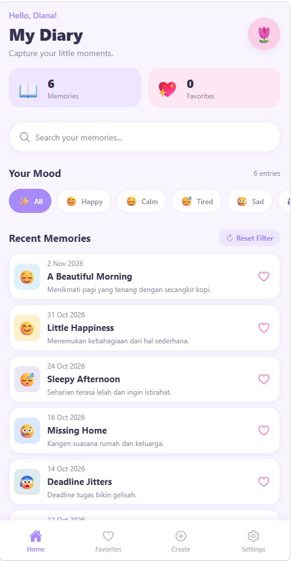
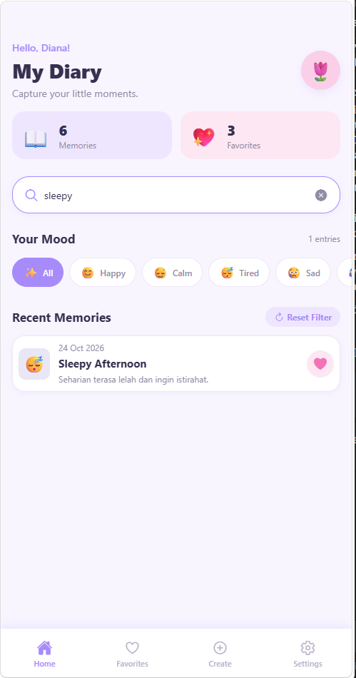
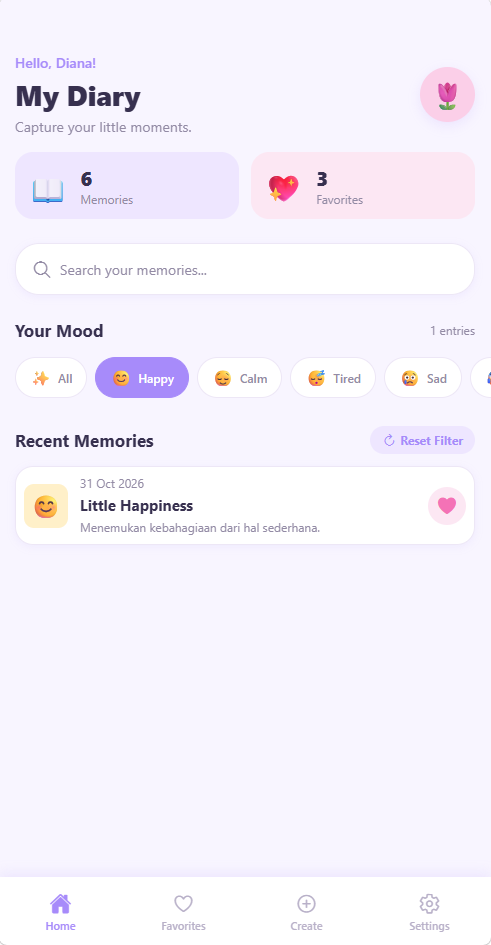
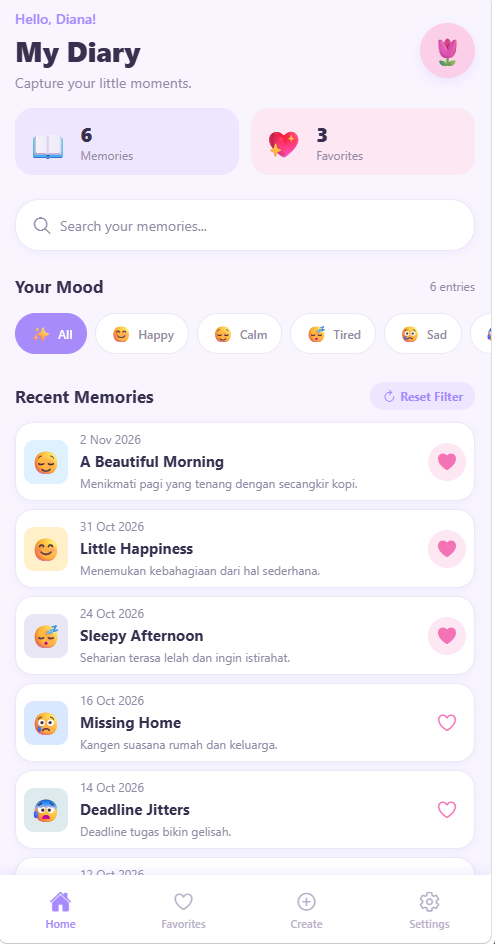
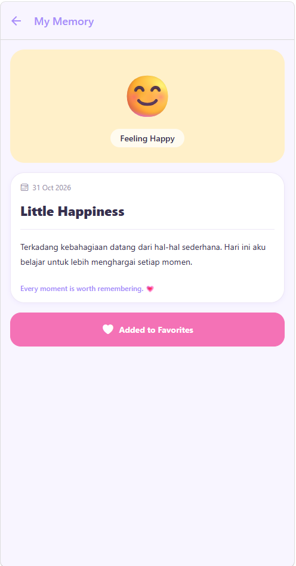
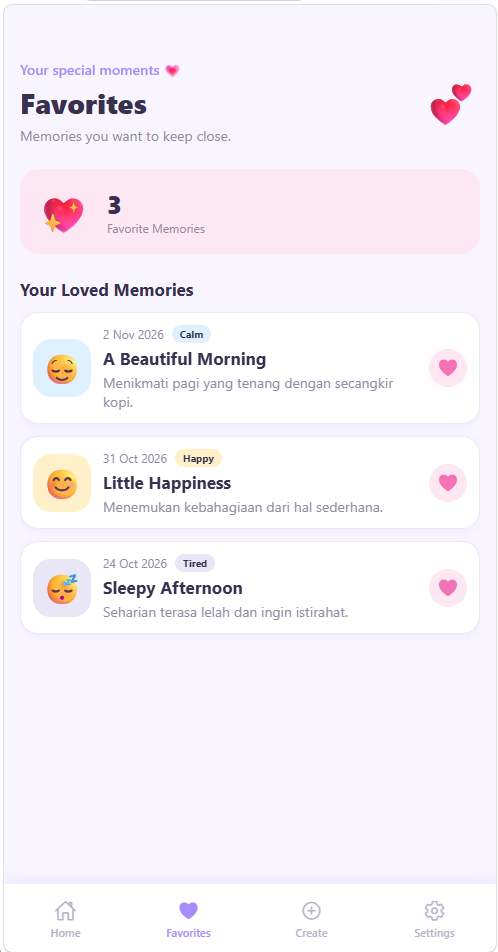
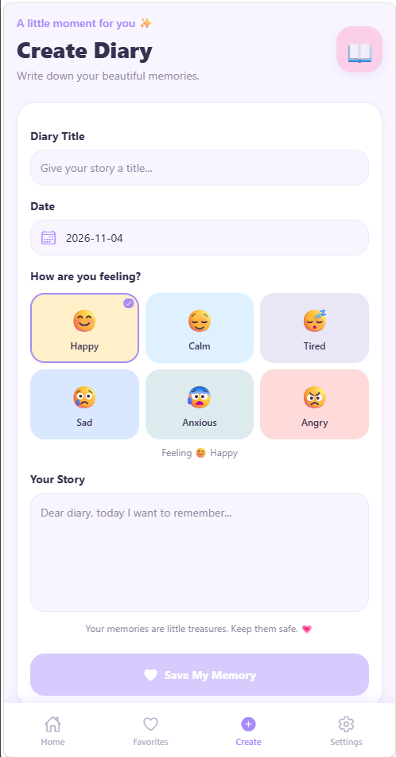
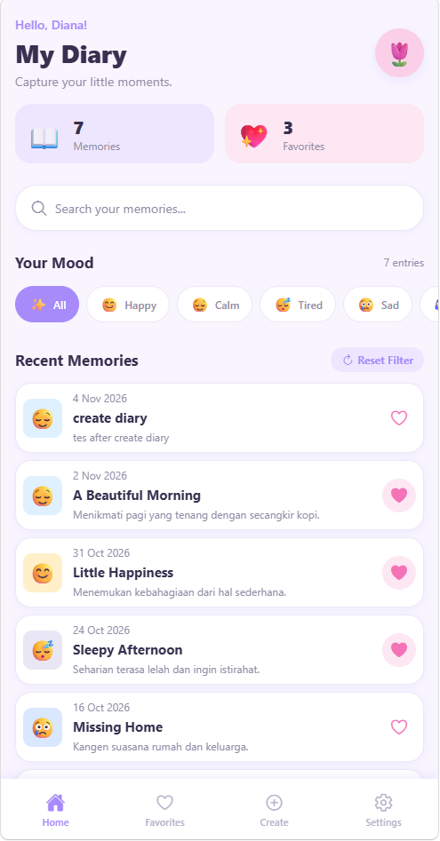
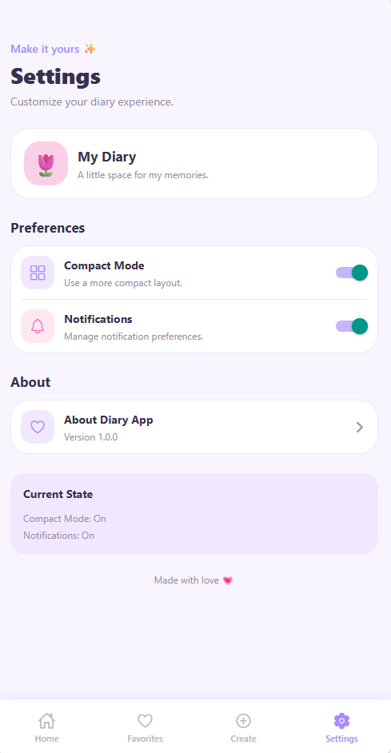
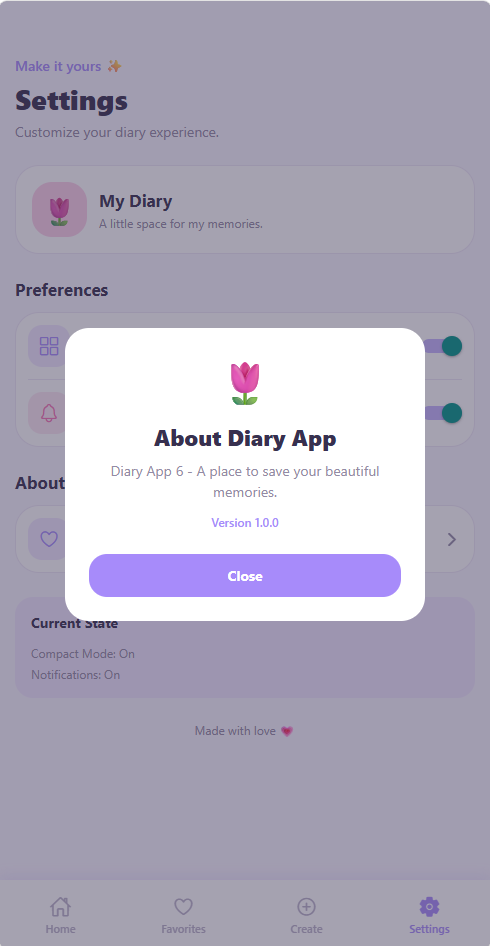

# 📖 Diary App 6

Aplikasi diary mobile sederhana yang dibuat dengan **React Native + Expo (Expo Router)** dan **TypeScript**. Pengguna bisa menulis catatan harian lengkap dengan mood, mencari dan memfilter catatan, menandai favorit, melihat detail, serta mengatur tampilan (compact mode).

## 👤 Identitas

| | |
|---|---|
| **Nama** | `[DIANA ANIS FARDAH]` |
| **NIM** | `[2430511046]` |
| **Program Studi** | Teknik Informatika |
| **Universitas** | Universitas Muhammadiyah Sukabumi |

## 🚀 Cara Menjalankan Project

### Prasyarat
- [Node.js](https://nodejs.org/) (disarankan versi LTS terbaru) dan npm
- Aplikasi **Expo Go** di HP (Android/iOS), *atau* emulator Android/iOS, *atau* browser untuk versi web

### Langkah-langkah

```bash
# 1. Masuk ke folder project
cd diary-app6

# 2. Install dependency
npm install

# 3. Jalankan development server
npx expo start
```

Setelah server jalan, pilih salah satu cara membuka aplikasi:

| Target | Cara |
|---|---|
| **HP (Expo Go)** | Scan QR code yang muncul di terminal (HP dan laptop harus satu jaringan Wi-Fi) |
| **Android emulator** | Tekan `a` di terminal, atau `npm run android` |
| **iOS simulator** (macOS) | Tekan `i` di terminal, atau `npm run ios` |
| **Browser (web)** | Tekan `w` di terminal, atau `npm run web` |

### Script yang tersedia

| Perintah | Fungsi |
|---|---|
| `npm start` | Menjalankan Expo dev server |
| `npm run android` | Menjalankan di Android |
| `npm run ios` | Menjalankan di iOS |
| `npm run web` | Menjalankan di browser |

## 🗂️ Struktur Folder

```
diary-app6/
├── app/
│   ├── _layout.tsx            # Root layout (DiaryProvider + Stack)
│   ├── (tabs)/
│   │   ├── _layout.tsx        # Bottom tab navigation
│   │   ├── index.tsx          # Home: search, filter mood, daftar diary
│   │   ├── favorites.tsx      # Daftar diary favorit
│   │   ├── create.tsx         # Form tambah diary
│   │   └── settings.tsx       # Pengaturan (compact mode, notifikasi)
│   └── detail/[id].tsx        # Detail diary (dynamic route)
└── src/
    ├── components/DiaryCard.tsx       # Komponen kartu diary
    ├── context/DiaryContext.tsx       # State global (Context API)
    ├── hooks/
    │   ├── useDiarySearch.ts          # Custom hook: search + filter mood
    │   └── useLikedEntries.ts         # Custom hook: daftar favorit
    └── styles/tokens.ts               # Design tokens (warna, spacing, dll.)
```

## 🪝 Penjelasan Hooks

### Hooks bawaan React

| Hook | Digunakan di | Fungsi dalam project |
|---|---|---|
| `useState` | `DiaryContext.tsx`, `useDiarySearch.ts`, `create.tsx`, `settings.tsx` | Menyimpan state lokal/global: daftar `entries`, `likedIds`, `compactMode`, `query`, `debouncedQuery`, `selectedMood`, input form (`title`, `date`, `body`, `mood`), dan toggle `notifications`. |
| `useEffect` | `useDiarySearch.ts` | Membuat **debounce** pencarian: `debouncedQuery` baru diperbarui 350 ms setelah user berhenti mengetik. *Cleanup function* (`clearTimeout`) membatalkan timer lama agar tidak menumpuk. |
| `useMemo` | `DiaryContext.tsx`, `useDiarySearch.ts`, `useLikedEntries.ts` | Menghindari kalkulasi ulang yang tidak perlu: memoize `value` context, hasil `filteredEntries` (filter query + mood), dan `likedEntries` (diary yang di-like). |
| `useCallback` | `index.tsx`, `favorites.tsx` | Memoize fungsi `openDetail` supaya referensinya stabil di antara render dan tidak dibuat ulang tiap render. |
| `useContext` | `DiaryContext.tsx` (dibungkus `useDiary`) | Membaca state global dari `DiaryContext` tanpa *prop drilling*. Melempar error jika dipakai di luar `DiaryProvider`. |

### Hooks dari Expo Router

| Hook | Digunakan di | Fungsi dalam project |
|---|---|---|
| `useRouter` | `index.tsx`, `favorites.tsx`, `create.tsx` | Navigasi antar halaman: `router.push` ke halaman detail dan `router.replace('/')` kembali ke Home setelah menyimpan diary. |
| `useLocalSearchParams` | `detail/[id].tsx` | Mengambil parameter `id` dari dynamic route untuk menentukan diary mana yang ditampilkan. |

### Custom Hooks

| Hook | File | Parameter | Return | Fungsi |
|---|---|---|---|---|
| `useDiary` | `src/context/DiaryContext.tsx` | – | `entries`, `likedIds`, `compactMode`, `setCompactMode`, `addEntry`, `toggleLike`, `getById` | Akses ke state dan aksi global diary dari komponen mana pun. |
| `useDiarySearch` | `src/hooks/useDiarySearch.ts` | `entries: DiaryEntry[]` | `query`, `setQuery`, `selectedMood`, `setSelectedMood`, `filteredEntries`, `resultCount`, `resetFilter` | Mengelola pencarian (dengan debounce) dan filter mood pada daftar diary. Pencarian mencocokkan judul, preview, tanggal, dan isi. |
| `useLikedEntries` | `src/hooks/useLikedEntries.ts` | `entries`, `likedIds: Set<number>` | `likedEntries`, `likedCount` | Menyaring diary yang di-like untuk halaman Favorites beserta jumlahnya. |

## 📸 Screenshot

### Home
| Daftar diary | Pencarian (`sleepy`) | Filter mood  |
|:---:|:---:|:---:|
|  |  |  |

### Favorit & Detail
| Like di Home | Detail diary | Halaman Favorites |
|:---:|:---:|:---:|
|  |  |  |

### Create & Settings
| Form Create | Home setelah menyimpan | Settings |
|:---:|:---:|:---:|
|  |  |  |

### About
| Settings → About Diary App |
|:---:|
|  |

Menekan kartu **About Diary App** menampilkan `Alert` berisi: *"Diary App 6 - A place to save your beautiful memories. 🌷"*.

## 🛠️ Teknologi

- Expo SDK 58 & Expo Router (file-based routing)
- React 19 & React Native 0.88
- TypeScript
- `@expo/vector-icons` (Ionicons)
